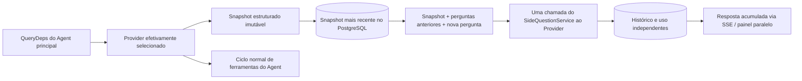

# ARTEX `/btw`

Conversas comuns, o MainAgent de uma tarefa e os Workers da tarefa aceitam perguntas paralelas independentes. Digite `/btw pergunta` no campo principal para enviar. Um `/btw` vazio ou o botão de pergunta paralela abre o histórico. Em desktop, a interface usa uma barra lateral redimensionável; em dispositivos móveis, usa um Drawer.

A resposta é gerada a partir de um snapshot do contexto do Agent no momento do envio. Há suporte a streaming, perguntas subsequentes, interrupção e limpeza. Fechar o painel, atualizar a página ou desconectar o SSE não cancela o modelo. Interromper afeta somente a solicitação atual; limpar cancela a solicitação e apaga o histórico paralelo, mas preserva o snapshot principal.

## Limites da implementação

A implementação reutiliza Go, norma v0.3.7, Next.js e os componentes Markdown, ResizablePanel, Drawer e AlertDialog existentes. O código-fonte do norma não foi alterado e nenhuma dependência específica foi adicionada. Planner, Workers herdados de outras tarefas e upgrades de subtarefas de ferramentas estão fora deste escopo.

- `capture.go` marca apenas chamadas do ciclo principal em `Options.Deps.CallModel / CallModelSync`. O decorator fica dentro do modelo concreto e depois da seleção do pool, registrando o modelo realmente escolhido. Compressão e resumo não sobrescrevem o snapshot.
- O início da chamada, a resposta completa e o estado terminal publicam snapshots. Respostas parciais não são publicadas. `MessagesForAPI`, do norma, mantém chamadas e resultados de ferramentas pareados. Se o streaming for interrompido, o último limite válido é preservado.
- Uma cópia profunda via JSON preserva mensagens estruturadas, system prompt, definições de ferramentas e parâmetros de geração. A inferência não mantém locks do snapshot nem transações do banco.
- `SideQuestionService` chama o Provider concreto. Quando necessário, gera primeiro um resumo. Se a primeira chamada exceder o contexto sem produzir texto ou ferramenta, o contexto pode ser reduzido e tentado mais uma vez. Não é criada uma agent session e não há acesso ao executor de ferramentas, transcript principal, atividade ou grafo da tarefa.
- Cada sessão pai executa no máximo uma solicitação; cada processo aceita no máximo quatro simultâneas. O timeout é de 120 segundos e o cancelamento é independente do fluxo principal.
- A solicitação preserva a referência da configuração do modelo e um resumo de identidade sem segredos. As credenciais são lidas da configuração vigente. Se o perfil for removido ou sua identidade mudar, o Agent principal deve rodar novamente para atualizar o snapshot.

## Persistência e recuperação

`db/schema.sql` cria automaticamente `side_question_sessions` e `side_question_requests`. A primeira tabela guarda o recurso pai, o snapshot mais recente, o identificador da execução, a versão e a versão de limpeza. A segunda guarda pergunta, resposta acumulada, estado, modelo, horário do snapshot, uso, sequência de eventos e ordinal de paginação.

A chave pai é o conversation ID ou a combinação task ID + exploration ID + intent ID. Workers não usam nomes reutilizáveis de slots de execução.

Snapshots são atualizados por sessão pai, no máximo a cada 250 ms. O banco compara `(run_id, version)` para impedir que uma versão antiga sobrescreva a nova. Antes de enviar uma pergunta, o snapshot escolhido é persistido novamente. Respostas acumuladas também são gravadas no máximo a cada 250 ms; estados terminais são gravados imediatamente, com retentativas limitadas.

Na inicialização, solicitações deixadas como `running` passam para `interrupted`, preservando resposta parcial e uso já persistidos. Elas não são reproduzidas automaticamente. O último contexto salvo pode ser usado na pergunta seguinte; sessões antigas sem snapshot exigem uma nova execução do Agent principal.

Limpar incrementa a versão de limpeza e remove as solicitações. Atualizações condicionais impedem callbacks atrasados de recriar dados. A exclusão física do recurso pai usa cascade; a exclusão lógica de Worker remove os dados paralelos na mesma transação. O arquivamento bloqueia novas perguntas, aguarda o fluxo principal, cancela e espera a persistência. O formato v3 inclui essas tabelas e continua compatível com v1/v2.

O histórico completo é paginado por ordinal, com até 20 itens por página. No máximo 20 pares bem-sucedidos recentes são reproduzidos no modelo, respeitando o orçamento de tokens; pares antigos entram em um resumo incremental. Se o contexto principal exceder o orçamento, somente a cópia antiga é resumida, preservando chamadas e resultados recentes de ferramentas. Veja [orçamento de contexto e referências](CONTEXT_BUDGET.md).

## Contrato HTTP

Os caminhos abaixo podem ser usados como `{parent}` e mantêm as regras atuais de autenticação e propriedade:

- `/api/conversations/{id}`
- `/api/tasks/{id}/chat`
- `/api/tasks/{id}/intents/{iid}`

| Requisição | Retorno e comportamento |
| --- | --- |
| `GET {parent}/side-questions?before={ordinal}` | `items` do mais novo ao mais antigo, estado `current`, metadados de `snapshot` e `next_cursor`; cursor 0 representa a página mais recente ou o fim |
| `POST {parent}/side-questions` | JSON `{ "question": "…", "client_request_id": "UUID" }`; uma nova solicitação retorna 202; o mesmo ID e pergunta retornam o objeto existente com 200 |
| `DELETE {parent}/side-questions` | Cancela e limpa as perguntas paralelas do pai atual |
| `GET /api/side-questions/{requestID}/events` | Eventos SSE `snapshot`, com `id` crescente e `data` contendo o objeto acumulado; a limpeza envia `cleared` |
| `POST /api/side-questions/{requestID}/cancel` | Cancela explicitamente; o estado terminal fica disponível no histórico ou no SSE |

A pergunta aceita até 4.000 caracteres. Snapshot ausente, perfil alterado, sessão pai ocupada ou conflito de idempotência retornam 409; o limite global retorna 429. Toda conexão SSE começa com o estado acumulado. O frontend combina eventos por request ID e sequência e descarta callbacks antigos ao trocar de pai ou limpar.

## Validação e referências

Consulte [VALIDATION.md](VALIDATION.md) para testes, uso de modelos reais e limitações conhecidas.

As referências são [Grok CLI side-question.ts, commit fixo](https://github.com/superagent-ai/grok-cli/blob/fb97af83f06dca873281d60168430f06c8de6324/src/utils/side-question.ts) para solicitações independentes e [OpenCode, commit fixo](https://github.com/anomalyco/opencode/tree/b3f1a96c6dd7adeb28b36dd11add1998fc84d67b) para isolamento. O ARTEX preserva as mensagens estruturadas do norma e não reconstrói o contexto concatenando logs do frontend.
