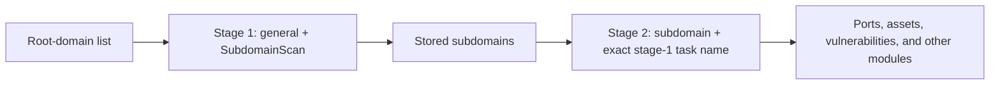

# ScopeSentry MCP Guide

This skill is for users with an existing ScopeSentry deployment. It connects Cursor, or another MCP client, to the platform without requiring the ScopeSentry source code locally.

## 1. Setup

### 1.1 Confirm connectivity

- Default web interface: `http://<host>`
- MCP endpoint: `http://<host>/mcp` (use the actual `/mcp` URL when a reverse proxy or frontend proxy is present)

### 1.2 Create an API key

1. Sign in to the ScopeSentry web interface.
2. Open the **API Key** page and create a key, or use an administrator-provided endpoint.
3. Save the returned `ssk_...` value. It is displayed only once.

### 1.3 Configure Cursor MCP

In Cursor, open Settings → MCP → Add Server:

```json
{
  "mcpServers": {
    "scopesentry": {
      "url": "http://<your-host>:8082/mcp",
      "headers": {"X-API-Key": "ssk_your-key"}
    }
  }
}
```

Alternatively, use `Authorization: Bearer ssk_your-key`. Restart MCP or reload Cursor, then confirm that tools such as `list_projects` and `list_assets` are available.

## 2. Tool Reference

| Tool | Purpose |
| --- | --- |
| `list_projects` | Project tree grouped by label, including project IDs |
| `list_projects_data` | Paginated project list with name search |
| `get_project` / `create_project` | Read or create a project |
| `list_tasks` / `get_task` | List tasks or read task details |
| `list_scan_templates` / `get_scan_template` | List templates or read template details |
| `list_plugin_modules` | Scan-pipeline module names |
| `list_plugins` | Available plugins, hashes, and default parameters |
| `create_scan_template` / `create_scan_task` | Create a template or scan task |
| `list_assets` | Query paginated asset lists |
| `count_assets` | Count assets through `/api/assets/common/total` |
| `get_asset_detail` / `add_asset_tag` | Read asset details or add a tag |
| `list_nodes` | Scan-node list |

Use each MCP tool's schema as the source of truth. `list_assets` and `count_assets` share the same `search` and `filter` syntax. Use `count_assets` when only the total is needed.

## 3. Common Workflows

### 3.1 Query assets by project

When a project is known, use `filter.project` to reduce cross-project data and improve response time. Do not require it when no project context exists.

1. Use `list_projects` or `list_projects_data` to obtain the project **ObjectID** from `id` or `children[].value`.
2. Pass that ID to `list_assets` in `filter.project`. Never pass the project's display name.

```json
{
  "asset_type": "asset",
  "pageIndex": 1,
  "pageSize": 20,
  "search": "domain=^example.com",
  "filter": {"project": ["<project-object-id>"]}
}
```

### 3.2 Create a scan task

1. Use `list_nodes` to obtain online node names.
2. Use `list_scan_templates` or `create_scan_template` to obtain a template **ObjectID**.
3. Call `create_scan_task`. `name` and `node` are required; `template` must be the template ID, not its name.

| `targetSource` | Meaning | Required input |
| --- | --- | --- |
| `general` | Direct target input | `target` |
| `project` | Read targets from projects | `project`, an array of project ObjectIDs |
| `asset` | Search the web-asset repository | `search`; optional `project`, `filter`, `targetNumber` |
| `RootDomain` | Search the root-domain repository | `search`; optional `project`, `filter`, `targetNumber` |
| `subdomain` | Search the subdomain repository | `search`; optional `project`, `filter`, `targetNumber` |
| `UrlScan` | Search URL-scan results | `search`; optional `project`, `filter`, `targetNumber` |
| `*Source`, such as `subdomainSource` | Create from asset-page selections/searches | `search` for `targetTp=search`; `targetIds` for `targetTp=select` |

Direct root-domain scan:

```json
{
  "name": "example-subdomain-discovery",
  "node": ["node-1"],
  "template": "<template-object-id>",
  "targetSource": "general",
  "target": "example.com\nfoo.com",
  "project": ["<project-object-id>"]
}
```

Continue from subdomains produced by that task:

```json
{
  "name": "example-ports-and-vulnerabilities",
  "node": ["node-1"],
  "template": "<follow-up-template-object-id>",
  "targetSource": "subdomain",
  "search": "task==\"example-subdomain-discovery\"",
  "project": ["<project-object-id>"]
}
```

### 3.3 Full root-domain collection: two-stage flow

Use two tasks instead of one complete pipeline. Distributed work is assigned per target; keeping a root domain as the sole target can make every discovered subdomain continue on one node, causing uneven load and slow or unreliable scans.

1. **Stage 1 — subdomain discovery only**
   - Set `targetSource` to `general` and put all root domains in multiline `target` input.
   - Enable only `SubdomainScan` and `SubdomainSecurity`.
   - Use `get_task` to wait for completion.
2. **Stage 2 — follow-up modules**
   - Set `targetSource` to `subdomain`.
   - Set `search` to `task=="<stage-1-task-name>"`.
   - Optionally restrict results with `project`.
   - Enable port scanning, asset mapping, vulnerability scanning, and other follow-up modules.

This distributes individual subdomains across nodes. The equivalent web workflow is to filter the Subdomains asset page by task name and select “Create task from subdomains.”



### 3.4 Create a scan template

1. Call `list_plugin_modules` for module names.
2. Call `list_plugins`, optionally filtered by `module`, for plugin hashes and default `parameter` values.
3. Call `create_scan_template` and use `modules` to map each module to an array of plugin hashes.

## 4. Asset Queries

`count_assets` and `list_assets` accept the same `asset_type`, `search`, and `filter` values. `count_assets` returns `{ "total": N }`.

```json
{
  "asset_type": "subdomain",
  "search": "task==\"task-name\"",
  "filter": {"project": ["<project-object-id>"]}
}
```

For performance, use `filter.project` when the project is known. Prefer indexed exact matches with `==` or prefix matches with `^`; broad `=` regex searches can be slow.

### 4.1 Asset types

`asset`, `RootDomain`, `subdomain`, `app`, `mp`, `UrlScan`, `SensitiveResult`, `DirScanResult`, `crawler`, `vulnerability`, `PageMonitoring`, `IPAsset`, `SubdomainTakerResult`

Aliases include `web` → `asset`, `vuln` → `vulnerability`, `ip` → `IPAsset`, and `url` → `UrlScan`.

### 4.2 Parameters

| Parameter | Meaning |
| --- | --- |
| `pageIndex` / `pageSize` | Pagination; defaults to 1 / 20 |
| `search` | Search expression |
| `filter` | Exact-filter JSON object |
| `sort` | Sort by `length`; only for `UrlScan` and `DirScanResult` |
| `sid` | Sensitive-rule name; only for `SensitiveResult` |

`search` and `filter` can be used together.

### 4.3 `search` expressions

This is a custom DSL, not SQL.

| Operator | Meaning | Uses index | Example |
| --- | --- | --- | --- |
| `=` | Fuzzy regex match | No | `domain=example` |
| `==` | Exact match | Yes | `port==443` |
| `!=` | Exclusion | — | `port!="80"` |
| `&&` | AND | — | `domain==example.com && port==443` |
| `||` | OR | — | `title=admin || body=login` |

Indexed fields such as `domain`, `ip`, `port`, and `title` use their index only with `==` or a `^` prefix expression such as `domain=^example.com`. A plain `=` becomes a regex search. Common fields for all types are `tag`, `task`, and `rootDomain`. Do not put `project` in `search`; use `filter.project`.

| `asset_type` | Common search fields |
| --- | --- |
| `asset` | domain, ip, port, service, app, title, statuscode, icon, banner, type, body, header |
| `RootDomain` | domain, icp, company |
| `subdomain` | domain, ip, type, value |
| `app` / `mp` | name, icp, company, category, description, url; `app` also supports apk |
| `UrlScan` | url, input, source, resultId, type |
| `SensitiveResult` | url, sname, body, info, md5 |
| `DirScanResult` | url, statuscode, redirect, length |
| `vulnerability` | url, vulname, matched, request, response, level |
| `crawler` | url, method, body, resultId |
| `PageMonitoring` | url, hash, diff, response |
| `IPAsset` | ip, domain, port, service, webServer, app |
| `SubdomainTakerResult` | domain, value, type, response |

Examples: `domain==www.example.com && port==443`, `domain=^example.com`, `ip==192.168.1.1`, `task=="task-name"`, `level==high`, and `statuscode==200`.

### 4.4 Exact `filter` values

Multiple values under one key use OR; different keys use AND.

| Filter key | Meaning | Typical value |
| --- | --- | --- |
| `project` | Owning project | Project ObjectID |
| `task` | Source task | Task name |
| `port` / `service` | Port or protocol | `"443"`, `"https"` |
| `app` / `icon` | Application fingerprint or icon hash | `"Nginx"`, hash value |
| `statuscode` | HTTP status | Primarily for `asset` |
| `status` | Processing or HTTP status | URL/dir scans, vulnerabilities, sensitive data |
| `level` | Vulnerability severity | critical, high, medium, low, info |
| `type` | Record/type value | A, CNAME, and similar values |
| `color` / `sname` | Sensitive-rule color or name | `SensitiveResult` |
| `tags` | Tags | Tag values |

| `asset_type` | Supported filter keys |
| --- | --- |
| `asset` | project, port, service, app, icon, statuscode, type, task, tags |
| `RootDomain` | project, tags |
| `subdomain` | project, type, task, tags |
| `app` / `mp` | project, tags |
| `UrlScan` / `DirScanResult` | status, tags |
| `SensitiveResult` | status, color, sname, tags |
| `crawler` | project, task, tags |
| `vulnerability` | project, level, status, task, tags |
| `PageMonitoring` / `SubdomainTakerResult` | tags |
| `IPAsset` | project, port, service, app |

```json
{"project": ["<project-object-id>"], "port": ["443"]}
```

```json
{
  "asset_type": "asset",
  "search": "domain=^example && port==443",
  "filter": {"project": ["<project-object-id>"]},
  "pageIndex": 1,
  "pageSize": 10
}
```

Use `filter.status` for URL-scan HTTP status. `DirScanResult` can use `statuscode==200` in `search`. For `SensitiveResult`, use `sname=rule-name` or `filter.sname`.

### 4.5 Sorting

Only `UrlScan` and `DirScanResult` support `{"length": "ascending"}`. Other asset types ignore `sort` and use the default time order.

## 5. Scan-template Module Names

`TargetHandler`, `SubdomainScan`, `SubdomainSecurity`, `PortScanPreparation`, `PortScan`, `PortFingerprint`, `AssetMapping`, `AssetHandle`, `URLScan`, `WebCrawler`, `URLSecurity`, `DirScan`, `VulnerabilityScan`, `PassiveScan`

## 6. Troubleshooting

| Symptom | Resolution |
| --- | --- |
| MCP exposes no tools | Check the URL, API key, and ScopeSentry service status |
| 401 / 403 | Create or replace the API key |
| No assets found | Confirm that `filter.project` contains an ObjectID; do not put `project` in `search` |
| Template/task creation fails | `template` must be a template ObjectID and `node` an online node name |
| Query is slow or stalls | Add `filter.project`, use `==` or `^`, avoid broad `=` searches, and reduce `pageSize` |
